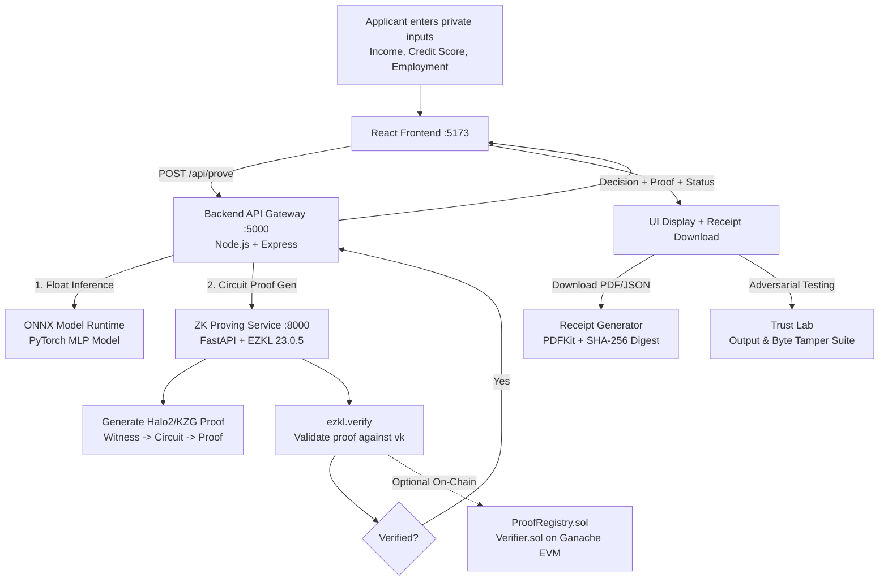
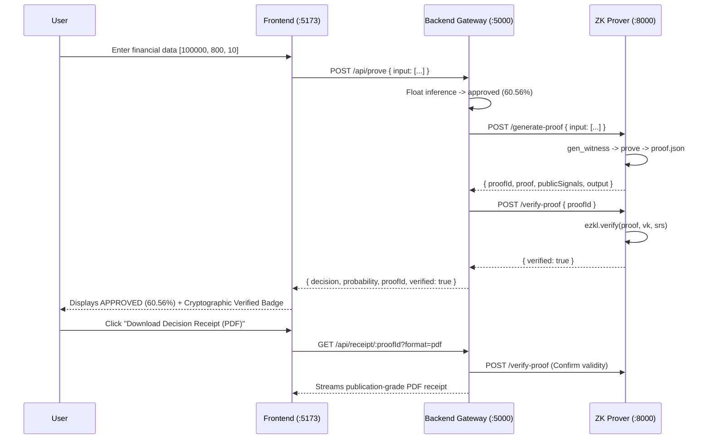

# Veriscore — Privacy-Preserving AI Decision Verification

> **Trust AI. Keep Data Private.**

Veriscore mathematically proves that an AI model produced a specific outcome **without exposing the applicant's private financial data or the proprietary model weights** — using Zero-Knowledge Machine Learning (zkML).

The core demonstration implements an automated **loan / credit-approval pipeline**: an applicant submits private financial data, receives an approve/deny classification with a probability score, and generates a small cryptographic **zero-knowledge proof**. Anyone — an applicant, an auditor, an enterprise compliance officer, or an on-chain smart contract — can verify the proof in milliseconds with zero access to sensitive inputs.

Additionally, Veriscore features an interactive **Trust Lab** for testing adversarial mutations and a **Verifiable AI Decision Receipt** generator producing official cryptographic PDF and JSON receipts.

---

## 1. Problem Statement

Modern AI models are increasingly deployed to make high-impact decisions in credit lending, insurance underwriting, and healthcare triage. Today, verifying that an AI decision was computed faithfully requires two compromised choices:

1. **Run the model locally**: Requires disclosing the model's proprietary weights and architecture.
2. **Trust a centralized API**: Requires transmitting raw, confidential financial or medical data to third-party servers with no mathematical guarantee that the server executed the correct model, used uncorrupted parameters, or evaluated the applicant's real inputs.

**Zero-Knowledge Machine Learning (zkML)** resolves this trilemma: the server executes the AI model inside a cryptographic circuit and produces a succinct **Halo2/KZG proof** alongside the decision. Anyone can verify this proof in milliseconds:
- **Private Input**: Financial features (`income`, `credit_score`, `years_employed`) remain hidden in the prover witness polynomial.
- **Fixed Model**: The model architecture and parameters are baked into the circuit proving and verifying keys.
- **Public Output**: The loan decision and probability are public, verifiable, and non-repudiable.

---

## 2. Key Features

- **End-to-End zkML Loan Classification**:
  A 3-feature binary classification PyTorch MLP (`3 → 8 → 4 → 1`) with baked-in z-score normalization and Sigmoid activation, calibrated and compiled into a Halo2 arithmetic circuit using EZKL.
- **Sub-Second Proving & Millisecond Verification**:
  Generates succinct SNARK proofs (~26.9 KB, $2^{12}$ constraint rows) in ~1.5 seconds, verifying in ~0.03 seconds on consumer CPU hardware.
- **Adversarial Trust Lab (`/trust-lab`)**:
  A dedicated testing suite demonstrating real-time cryptographic failure modes:
  - *Baseline Verification*: Validates authentic proofs against `verifying.key`.
  - *Public Output Tampering*: Simulates outcome-forgery attacks by altering decision instances, triggering Halo2 constraint system failures.
  - *Proof Byte Tampering*: Mutates bytes in the cryptographic transcript, triggering KZG elliptic curve point encoding failures on BN254.
  - *Dual Tampering*: Mutates outputs and transcripts simultaneously.
  - *Custom JSON Playground*: Interactive payload editor testing custom JSON payloads against the verifier.
  - *Zero-Disk Overwrite Guarantee*: All tamper experiments run in ephemeral workspaces; original disk artifacts are never modified.
- **Verifiable AI Decision Receipts (PDF & JSON)**:
  - One-click downloadable decision receipts certifying model execution, decision verdict, and ZK verification status.
  - Publication-grade vector PDF generated via PDFKit with official seals, SHA-256 receipt integrity digest, and privacy notice.
  - Machine-readable JSON receipts for enterprise audit pipelines.
  - *Anti-Spoofing Enforcement*: The server independently validates proofs with the prover microservice before issuing receipts; unverified decisions are flagged with warning banners and never state `VERIFIED`.
  - *Zero Privacy Leakage*: Raw financial inputs, private keys (`proving.key`), and internal file paths are strictly excluded from all receipts.
- **Dual Off-Chain & On-Chain Verification**:
  - *Server-Side*: Native `ezkl.verify` via FastAPI microservice.
  - *In-Memory EVM*: Version-matched Solidity verifier (`Verifier.sol`) executed in an ephemeral EVM (`@ethereumjs/vm`).
  - *Local Blockchain*: Mined transactions demonstrating proof verification through a `ProofRegistry` contract on a local Ganache EVM chain (Chain ID `1337`).
- **MLaaS Model Registry**:
  Introspective `/api/models` registry describing model metadata, input shapes, supported INR ranges, and cryptographic parameters.

---

## 3. System Architecture & Workflow



### Proving & Verification Sequence



---

## 4. The AI Model & Circuit Calibration

| Property | Value | Notes |
|---|---|---|
| **Task** | Binary Loan Approval | Binary classification: Approved vs. Rejected |
| **Input Features** | `[person_income, credit_score, person_emp_exp]` | 3 numerical features |
| **Architecture** | PyTorch MLP (`3 → 8 → 4 → 1`) | ReLU activations, Sigmoid output |
| **Decision Threshold** | `≥ 0.50` (50.00%) | Approved if $P(\text{approval}) \ge 0.5$ |
| **Normalization** | Z-score normalization | Baked directly into the ONNX graph for end-to-end ZK proof |
| **Proving Engine** | EZKL `23.0.5` | Halo2 proving system with KZG polynomial commitments |
| **Elliptic Curve** | `bn254` (`alt_bn128`) | Pairing-friendly curve supported by EVM `ecPairing` precompile |
| **Circuit Size** | $2^{12}$ (4,096 constraint rows) | Calibrated with `decomp_legs = 3` (3×14-bit limb tower) |
| **Feature Capacity** | Up to ₹1,00,00,000 (1 Crore INR) | Accommodates large financial inputs without limb overflow |
| **Quantization Scales** | `input_scale = 11`, `param_scale = 18` | Fixed-point scale approximation preserving float accuracy |
| **Input Visibility** | **`Private`** | Inputs never appear in the proof, public instances, or receipts |
| **Output Visibility** | **`Public`** | Rescaled output instance is exposed for independent verification |

### Verified Test Examples

Measured against running services with genuine zero-knowledge proofs:

| Input Features `[Income, Credit, Exp]` | Probability | Decision | ZK Proof Result |
|---|---|---|---|
| `[25000, 450, 1]` | 39.19% | **REJECTED** | `verified: true` |
| `[30000, 450, 1]` | 40.16% | **REJECTED** | `verified: true` |
| `[50000, 600, 3]` | 40.98% | **REJECTED** | `verified: true` |
| `[80000, 750, 8]` | 52.31% | **APPROVED** | `verified: true` |
| `[100000, 800, 10]` | 60.56% | **APPROVED** | `verified: true` |
| `[120000, 800, 15]` | 60.46% | **APPROVED** | `verified: true` |

---

## 5. Trust Lab & Tamper Resistance

The **Trust Lab** (`/trust-lab`) allows operators and auditors to verify authentic proofs and deliberately inject adversarial mutations to validate that the cryptographic verifier rejects fraudulent data:

```
+---------------------------------------------------------------------------------------------------+
| VERISCORE TRUST LAB - ADVERSARIAL MATRIX                                                         |
+--------------------------+-----------------------+------------------------------------------------+
| Test Mode                | Expected Status       | Verifier Result & Cryptographic Trace          |
+--------------------------+-----------------------+------------------------------------------------+
| Original Baseline        | VERIFIED              | True (0.036s) - Constraints & pairing satisfied|
| Tamper Public Output     | REJECTED              | False - [halo2] Constraint system not satisfied|
| Tamper Proof Bytes       | REJECTED              | False - [halo2] Transcript invalid curve point |
| Dual Mutation (Both)     | REJECTED              | False - Layered constraint & transcript failure|
| Custom JSON Payload      | DYNAMIC               | Validates custom modified JSON in real time    |
+--------------------------+-----------------------+------------------------------------------------+
```

### Why Tampering Fails Mathematically

1. **Output Forgery Attack**: In Halo2 arithmetization, public inputs occupy instance columns constrained against the circuit output polynomial. Modifying the public instance $I(X)$ without re-evaluating the circuit prevents the quotient polynomial $q(X)$ from dividing the constraint polynomial $t(X)$, triggering immediate rejection.
2. **Transcript Corruption Attack**: The KZG proof contains group elements on BN254 $\mathbb{G}_1$. Mutating proof bytes corrupts the elliptic curve point encoding or breaks the bilinear pairing equality:
   $$e\left(W, [x - z]_2\right) \neq e\left(C - v \cdot [1]_1, [1]_2\right)$$
3. **Private Input Tampering**: Because inputs are configured with `input_visibility = Private`, raw applicant features exist exclusively in the temporary witness polynomial $w(X)$ during proving and are **never serialized into `proof.json`**. Attempting to prove a different applicant requires re-running the circuit.

---

## 6. Verifiable AI Decision Receipt

When an applicant receives a decision, the platform generates a cryptographic **Verifiable AI Decision Receipt** in both PDF and JSON formats:

### Receipt Properties

- **Receipt ID**: Unique alphanumeric receipt identifier (e.g., `VRC-9331BE2B5D8D`).
- **Proof ID**: UUID linking directly to the circuit proof artifact on disk.
- **Decision Verdict**: `APPROVED` or `REJECTED` with exact probability percentage.
- **Verification Status**: `VERIFIED` or `UNVERIFIED`.
- **Integrity Digest**: SHA-256 fingerprint computed across Proof ID, Decision, Probability, Verification Status, and Issuance Timestamp.
- **Cryptographic Specifications**: Documenting Proving Engine (`EZKL 23.0.5`), Curve (`BN254`), Scheme (`KZG`), Logrows (`12`), Scales (`[11, 18]`), and Public Signals (`instances[0][0]`).
- **Zero-Knowledge Privacy Commitment**: Formal notice certifying that applicant financial inputs were withheld from the receipt and public domain.
- **Anti-Spoofing Guarantee**: The backend validates every proof live with the verifier before receipt issuance. If a proof is corrupt, tampered, or missing, the receipt is issued with an explicit `UNVERIFIED` status and warning banner.

---

## 7. Technology Stack

| Layer | Technology | Details |
|---|---|---|
| **Machine Learning** | PyTorch, ONNX, ONNX Runtime | 3-layer MLP (`3 → 8 → 4 → 1`), trained on credit risk data, exported to ONNX |
| **Zero-Knowledge Engine** | [EZKL](https://github.com/zkonduit/ezkl) `23.0.5` | Halo2 proving system, KZG polynomial commitments, BN254 curve |
| **ZK Proving Microservice** | Python 3.13, FastAPI, Uvicorn | Proof generation, witness calculation, live verification, model registry |
| **Backend API Gateway** | Node.js v24, Express, CORS | Request validation, proving orchestration, receipt generation (`pdfkit`) |
| **Receipt Engine** | PDFKit, Node.js Crypto | Vector PDF receipts, SHA-256 digests, JSON export |
| **Frontend Application** | React 18, Vite 5, React Router 7 | Responsive UI, Trust Lab, status panels, proof inspection |
| **Styling & Animation** | Custom CSS variables, GSAP | Dark theme, neon accents, accessible status chips |
| **Client-Side EVM Verify** | `@ethereumjs/vm`, `@ethereumjs/common` | In-memory EVM execution of version-matched `Verifier.sol` |
| **Blockchain Integration** | Solidity 0.8.20, Ethers.js v6, Ganache | `Verifier.sol` (Halo2Verifier) + `Deployer.sol` (`ProofRegistry`) |

---

## 8. Repository Structure

```
veriscore/
├── artifacts/                     # Calibrated ZK artifacts
│   ├── settings.json              # Calibrated circuit settings (Private input, scales [11,18], logrows 12)
│   ├── model.compiled             # Compiled Halo2 circuit
│   ├── proving.key                # Private proving key (prover host only)
│   ├── verifying.key              # Public verification key
│   ├── kzg.srs                    # Universal KZG Structured Reference String
│   └── proofs/                    # Stored proofs ({proofId}/proof.json + meta.json)
├── backend-api/                   # Express Gateway (:5000)
│   ├── server.js                  # Routes: /api/predict, /api/prove, /api/verify, /api/trust-lab, /api/receipt
│   ├── receiptGenerator.js        # PDF & JSON receipt builder (PDFKit)
│   ├── predict_mlp.py             # ONNX Runtime model inference fallback
│   ├── call_prover.py             # Python CLI wrapper for proving pipeline
│   └── package.json
├── blockchain-verifier/           # On-Chain Verification
│   ├── Verifier.sol               # EZKL 23.0.5-generated Solidity verifier
│   └── Deployer.sol               # ProofRegistry contract (digest -> verifier)
├── client-verify/                 # Client-side verification harness
│   ├── evm-client-verify.js       # In-memory EVM proof verification
│   ├── evm-registry-demo.js       # ProofRegistry contract verification
│   └── ethers-chain-demo.js       # Local Ganache chain mined transactions
├── frontend/                      # React + Vite Client (:5173)
│   ├── src/
│   │   ├── pages/
│   │   │   ├── Landing.jsx        # Landing page with interactive hero
│   │   │   └── TrustLab.jsx       # Adversarial Tamper & Verification Lab
│   │   ├── components/            # Header, DemoForm, StatusPanel, ResultPanel, etc.
│   │   ├── services/api.js        # API client bindings
│   │   └── App.jsx                # Router configuration (/home, /trust-lab)
│   └── package.json
├── model-pipeline/                # Model training & quantization reference
│   ├── mlp_model.py               # PyTorch MLP definition
│   ├── train_final.py             # Model training script
│   ├── export_mlp_onnx.py         # ONNX export and parity validation
│   └── loan_data.csv              # Credit risk training dataset
├── models/loan_model/
│   └── model.onnx                 # Production ONNX model
├── zk-proving-service/            # FastAPI Prover (:8000)
│   ├── api_server.py              # Endpoints: /generate-proof, /verify-proof, /verify-tamper, /api/models
│   ├── prover_service.py          # EZKL execution core & non-destructive tamper testing
│   └── requirements.txt
├── e2e_test.py                    # 17-point end-to-end regression test suite
├── trust_lab_test.py              # 10-point Trust Lab adversarial test suite
├── receipt_test.py                # 8-point Decision Receipt verification test suite
└── README.md
```

---

## 9. API Reference

### ZK Proving Microservice (FastAPI — Port 8000)

| Method | Endpoint | Description |
|---|---|---|
| `GET` | `/health` | Service health status (`{"status":"ok"}`) |
| `POST` | `/generate-proof` | Generates a ZK proof for input `{"input":[income, credit, exp]}` |
| `GET` | `/proof/{proof_id}` | Retrieves stored proof and metadata by UUID |
| `POST` | `/verify-proof` | Verifies a stored proof by `{"proofId":"..."}` |
| `POST` | `/verify-tamper` | Runs non-destructive tamper test (`original`, `tamper_public_output`, `tamper_proof_bytes`, `tamper_both`, `custom`) |
| `GET` | `/api/trust-lab/recent-proofs` | Lists recent proofs stored on disk |
| `GET` | `/api/models` | Lists registered models in the MLaaS registry |
| `GET` | `/api/models/{model_id}` | Detailed specification of a registered model |
| `POST` | `/api/models/{model_id}/infer` | Unquantized float inference for target model |

### Backend API Gateway (Express — Port 5000)

| Method | Endpoint | Description |
|---|---|---|
| `GET` | `/api/health` | Gateway health check |
| `POST` | `/api/predict` | Fast float inference (`{input: [income, credit, exp]}`) |
| `POST` | `/api/prove` | Orchestrates inference + ZK proof generation + verification |
| `POST` | `/api/verify` | Verifies a previously generated proof ID |
| `POST` | `/api/trust-lab/verify` | Executes adversarial tamper tests via the proving microservice |
| `GET` | `/api/trust-lab/recent-proofs` | Lists recent proofs with input/output metadata |
| `GET` | `/api/receipt/:proofId` | Generates a decision receipt (`?format=pdf` or `?format=json`) |
| `POST` | `/api/receipt` | Validates proof live and outputs PDF or JSON receipt |
| `GET` | `/api/models[/:id]` | Passthrough to prover model registry |

---

## 10. Installation & Quick Start

### Prerequisites

- **Python 3.10+** (tested on Python 3.13.7)
- **Node.js 20+** (tested on Node v24.14.0, npm 11.9.0)
- Operating System: Windows, macOS, or Linux

### Environment Configuration

The backend and frontend use sensible defaults for local development. You can optionally configure environment variables:

| Variable | Service | Default | Description |
|---|---|---|---|
| `PORT` | Backend | `5000` | Port for Express gateway |
| `HOST` | Backend | `0.0.0.0` | Host interface binding |
| `PYTHON` | Backend | `python` | Python executable path |
| `PROVER_SERVICE_URL` | Backend | `http://127.0.0.1:8000` | URL for FastAPI proving microservice |
| `VITE_API_URL` | Frontend | `""` (proxied to :5000) | Backend gateway URL |

---

### Step-by-Step Setup

#### Terminal 1 — ZK Proving Microservice (:8000)

```powershell
cd zk-proving-service
python -m venv .venv
.\.venv\Scripts\Activate.ps1
pip install -r requirements.txt
python -m uvicorn api_server:app --port 8000
```

*(On Linux / macOS, activate with `source .venv/bin/activate`)*

#### Terminal 2 — Backend API Gateway (:5000)

```powershell
cd backend-api
npm install
node server.js
```

#### Terminal 3 — Frontend Application (:5173)

```powershell
cd frontend
npm install
npm run dev
```

Open **[http://localhost:5173](http://localhost:5173)** in your browser.

---

## 11. Standalone Verification Demos

The repository includes standalone scripts for client-side and on-chain verification:

```powershell
cd client-verify
npm install

# 1. In-memory EVM client-side verification
node evm-client-verify.js

# 2. Delegation through ProofRegistry contract
node evm-registry-demo.js

# 3. Local Ganache chain demonstration (requires local Ganache at 127.0.0.1:8545)
node ethers-chain-demo.js
```

---

## 12. Automated Test Suites

All tests run against live services and genuine cryptographic circuits:

### 1. End-to-End Regression Suite (`e2e_test.py`)
Executes 17 comprehensive checks covering inference, proof generation, verification, Vite proxy routing, error handling, and registry:
```powershell
python e2e_test.py
# Result: 17 passed, 0 failed
```

### 2. Trust Lab Adversarial Test Suite (`trust_lab_test.py`)
Validates baseline verification, public-output tampering, proof-byte tampering, dual mutations, proof immutability, and input validation:
```powershell
python trust_lab_test.py
# Result: 10 / 10 PASS
```

### 3. Verifiable Decision Receipt Test Suite (`receipt_test.py`)
Validates JSON receipts, PDF generation, zero raw-input leakage, failed-verification handling, and anti-spoofing controls:
```powershell
python receipt_test.py
# Result: 8 / 8 PASS
```

### 4. Frontend Production Build
```powershell
cd frontend
npm run build
# Result: 67 modules transformed, built in ~1.4s
```

---

## 13. UI Walkthrough & Screenshots

```
+------------------------------------------------------------------------------------------------+
| VERISCORE LANDING PAGE (http://localhost:5173/)                                               |
| "Verify AI Decisions. Without Revealing Private Data."                                        |
| [ Try AI Verification -> ]                     [ Enter Trust Lab -> ]                          |
+------------------------------------------------------------------------------------------------+

+------------------------------------------------------------------------------------------------+
| AI DECISION VERIFICATION (:5173/home)                                                         |
| [ Applicant Form ]                         [ Live Verification Panel ]                         |
| Annual Income:   ₹1,00,000                 VERDICT: APPROVED (60.56% probability)              |
| Credit Score:    800                       ✓ ZK Proof: Generated (~1.5s, 26.9 KB)              |
| Employment Exp:  10 years                  ✓ Cryptographic Verification: Verified              |
|                                            Proof ID: 513d0670-7de0-4bce...                     |
| [ Generate Proof & Decision ]              [ Download Decision Receipt (PDF) ] [ JSON Receipt ] |
+------------------------------------------------------------------------------------------------+

+------------------------------------------------------------------------------------------------+
| TRUST LAB (:5173/trust-lab)                                                                   |
| Target Proof: 513d0670-7de0-4bce... (Logrows: 12, Scales: [11, 18], Curve: BN254)              |
| [ Test 1: Original Proof ]   -> Status: VERIFIED (0.036s)                                      |
| [ Test 2: Tamper Output ]    -> Status: REJECTED ([halo2] Constraint system not satisfied)     |
| [ Test 3: Tamper Bytes ]     -> Status: REJECTED ([halo2] Transcript invalid curve point)      |
| [ Test 4: Dual Tamper ]      -> Status: REJECTED                                               |
| [ Interactive Custom JSON ]  -> Live Custom Payload Verification                               |
| [ Session Audit Trail Log ]  -> Real-time execution traces and error history                   |
+------------------------------------------------------------------------------------------------+
```

---

## 14. Security, Privacy & Honest Limitations

### What Is Cryptographically Guaranteed
- **Applicant Data Privacy**: Configured with `input_visibility = Private`. Financial features are processed strictly in the private witness and never stored in `proof.json`, receipts, or public calldata.
- **Circuit Integrity**: Proving and verifying keys are mathematically tied to the specific PyTorch MLP architecture and weights.
- **Deterministic Rejection**: Tampered public outputs or corrupted proof bytes are rejected by the underlying Halo2/KZG constraint checks.
- **Zero-Disk Overwrite**: All tamper tests in Trust Lab run in isolated memory/temporary files, preserving artifact immutability.

### Honest Engineering Limitations
- **Server-Side Proving**: In this architecture, proving is executed server-side. While zero-knowledge proofs protect the applicant's data from auditors, verifiers, and on-chain observers, the server operator receives the input during the HTTP request. Client-side browser proving via WebAssembly is future work.
- **Fixed-Point Quantization**: Continuous floating-point operations are mapped to a fixed-point limb tower ($3 \times 14$-bit limbs, capacity $2^{42}$). Extremely large feature values ($> \text{₹}1,00,00,000$) exceed limb capacity and are rejected at the gateway.
- **Hardware Acceleration**: Running on CPU. GPU-accelerated MSM requires an NVIDIA CUDA environment not configured in the standard container.
- **Local EVM Scope**: On-chain verification is demonstrated on an in-memory EVM and a local Ganache development chain; deployment to an Ethereum public testnet (e.g., Sepolia) is pending gas optimization.

---

## 15. Future Scope

- **Client-Side WASM Prover**: Generating the zero-knowledge witness and proof directly in the browser via WebAssembly so raw financial inputs never leave the client device.
- **Public Ethereum Testnet Deployment**: Deploying `ProofRegistry` and the EZKL `Halo2Verifier.sol` contract to Ethereum Sepolia with an automated block explorer verifier link.
- **GPU-Accelerated Proving**: Enabling CUDA-accelerated multi-scalar multiplication (MSM) to achieve sub-second proving for deeper models.
- **Decentralized Storage**: Anchoring proof artifacts and PDF receipts on IPFS/Filecoin with content-addressed cryptographic verification.

---

## 16. License

This repository is developed as an educational demonstration and prototype. All rights reserved. For questions or commercial inquiries regarding zkML verification integration, contact the project maintainers.